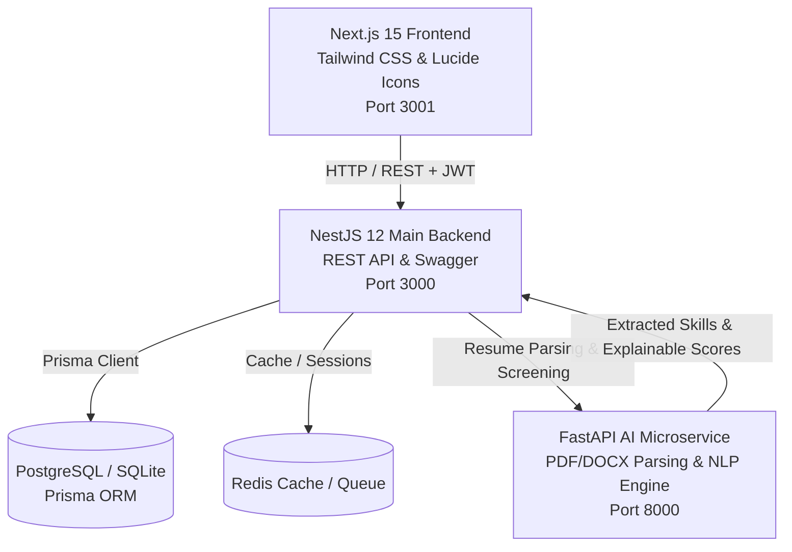

# HireFlow AI: AI-Powered Recruitment & HR Management System

[](https://nestjs.com/)
[](https://fastapi.tiangolo.com/)
[](https://nextjs.org/)
[](https://prisma.io/)
[](https://tailwindcss.com/)
[](https://www.docker.com/)

HireFlow AI is an enterprise-grade, end-to-end recruitment (ATS) and human resource management (HRIS) solution built for fast-moving organizations. It solves resume overload, slow recruitment cycles, fragmented interview scoring, and disconnected HR operations by unifying modern workflow automation with **Explainable, Human-in-the-Loop AI Screening**.

---

## Architecture Overview



---

## Key Modules & Capabilities

### Phase 1: AI-Powered Applicant Tracking System (ATS)
1. **Authentication & Role-Based Access Control (RBAC)**: Secure JWT authentication with 4 roles (`ADMIN`, `RECRUITER`, `HIRING_MANAGER`, `CANDIDATE`).
2. **Dashboard & Executive Analytics**: 8-stage recruitment funnel, real-time conversion rates, average time-to-hire, offer acceptance rate, and recent audit activity.
3. **Job Management**: Complete job requisitions with status workflows (`DRAFT`, `PUBLISHED`, `CLOSED`), role requirements, salary ranges, and department mapping.
4. **Candidate Management**: Unified talent database with duplicate detection, profile enrichments, and chronological application history.
5. **Job Application Workflow**: Interactive 8-stage Kanban board (`APPLIED`, `SCREENING`, `INTERVIEW_SCHEDULED`, `INTERVIEW_COMPLETED`, `OFFER_EXTENDED`, `OFFER_ACCEPTED`, `REJECTED`, `WITHDRAWN`) with real-time drag-and-drop state transitions.
6. **AI Resume Screening Engine**: Explainable scoring (0-100), automated skill gap analysis (Matched vs Missing skills), and mandatory recruiter human-in-the-loop override controls.
7. **Interview Scheduling & Evaluation**: Multi-round interview coordination, Google Meet generation, and structured scorecard ratings (1-5 scale) with hiring recommendations.
8. **Offer Management**: Generation of structured job offers, managerial approval pipelines, candidate accept/decline portal, and 1-click conversion into employee records.
9. **Notification Center**: Event-driven notifications for candidate status updates, interview schedules, and offer letters.

### Phase 2: Core HR Operations & Employee Management (HRIS)
10. **Employee Records Management**: Centralized staff directory with job titles, departments, work types (`REMOTE`, `HYBRID`, `ON_SITE`), and employment statuses (`ACTIVE`, `ON_LEAVE`, `TERMINATED`).
11. **Employee Onboarding**: Role-based checklist items (IT hardware provisioning, workspace access, compliance training) with trackable progress percentages.
12. **Leave Management**: Leave balance tracking (`ANNUAL`, `SICK`, `UNPAID`), request submission, and manager approval/rejection workflows.
13. **Attendance & Time Tracking**: Daily clock-in/clock-out logging, work hours calculation, and status tracking (`PRESENT`, `LATE`, `HALF_DAY`, `REMOTE`).
14. **HR Reports & Analytics**: Departmental headcount distributions, monthly hiring velocity, turnover metrics, and leave utilization.
15. **System Settings & Compliance**: Department creation, company-wide recruitment policies, and audit logging.

---

## Human-in-the-Loop Ethical AI

HireFlow AI strictly adheres to ethical recruitment standards:
- **No Automated Rejections**: The AI engine acts strictly as an advisory co-pilot to surface candidate strengths and potential skill gaps.
- **Explainable Scores**: Every score is accompanied by matching criteria, missing skills, and evidence citations extracted directly from the CV.
- **Recruiter Override**: Recruiters can override any AI recommendation with an auditable justification note.

---

## Tech Stack

| Tier | Technologies |
| :--- | :--- |
| **Frontend** | Next.js 15.1.7, React 19, Tailwind CSS, Lucide Icons, TypeScript |
| **Backend API** | NestJS 12, TypeScript, Prisma ORM, Passport.js, JWT, Swagger OpenAPI |
| **AI Engine** | Python 3.11, FastAPI, `pypdf`, `python-docx`, scikit-learn / NLP matching |
| **Database** | PostgreSQL 16 (Production) / SQLite (Zero-config local dev) |
| **Cache & Queue** | Redis 7 |
| **DevOps** | Docker, Docker Compose, Multi-stage builds |

---

## Quickstart Guide

### Option A: Local Development (Fastest, Zero-Config)

#### 1. Backend (NestJS)
```bash
cd backend
npm install
npm run prisma db push
npm run prisma db seed
npm run start:dev
```
*Backend runs on `http://localhost:3000` (Swagger docs available at `http://localhost:3000/api/docs`).*

#### 2. AI Microservice (FastAPI)
```bash
cd ai-service
python -m venv venv
# Windows:
.\venv\Scripts\activate
# Linux/macOS:
source venv/bin/activate

pip install -r requirements.txt
uvicorn main:app --reload --port 8000
```
*AI service runs on `http://localhost:8000` (Interactive docs at `http://localhost:8000/docs`).*

#### 3. Frontend (Next.js)
```bash
cd frontend
npm install
npm run dev
```
*Frontend runs on `http://localhost:3001`.*

---

### Option B: Docker Compose (Full Stack)

To run the complete system (PostgreSQL, Redis, AI Service, Backend, and Frontend) in Docker:

```bash
docker compose up --build
```

Access services:
- **Web App**: `http://localhost:3001`
- **Backend API**: `http://localhost:3000`
- **Swagger Documentation**: `http://localhost:3000/api/docs`
- **AI Microservice**: `http://localhost:8000`

---

## Default Seeded Credentials

The database is pre-seeded with accounts for all roles (Password: `Password123!`):

| Role | Email | Permissions |
| :--- | :--- | :--- |
| **Admin** | `admin@hireflow.ai` | Full administrative control, all ATS & HRIS modules |
| **Recruiter** | `recruiter@hireflow.ai` | Full ATS management, candidate screening & interviews |
| **Hiring Manager** | `manager@hireflow.ai` | Department jobs, candidate reviews, scorecard submission |
| **Candidate** | `alex.chen@hireflow.ai` | Job board access, application tracking, offer signing |

---

## Verification & Testing

- **Backend Integration Smoke Test**:
  ```bash
  cd backend
  node --experimental-strip-types test/smoke-test.ts
  ```
- **AI Service Unit & Extraction Test**:
  ```bash
  cd ai-service
  python test_ai_service.py
  ```
- **Frontend Production Build**:
  ```bash
  cd frontend
  npm run build
  ```

---

## License
MIT License. Built for enterprise talent acquisition and human resource management.
